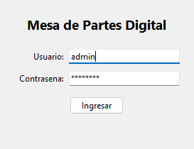
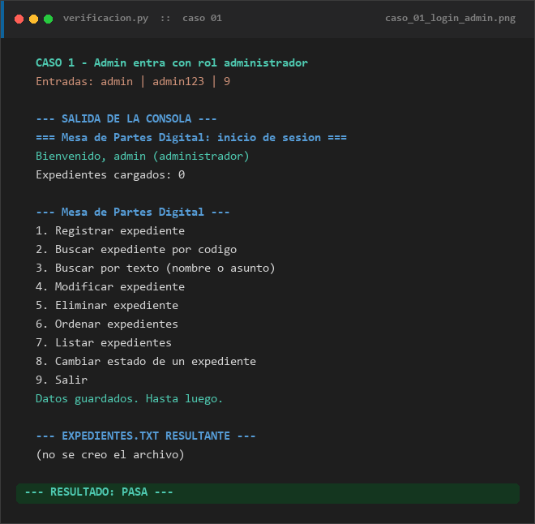
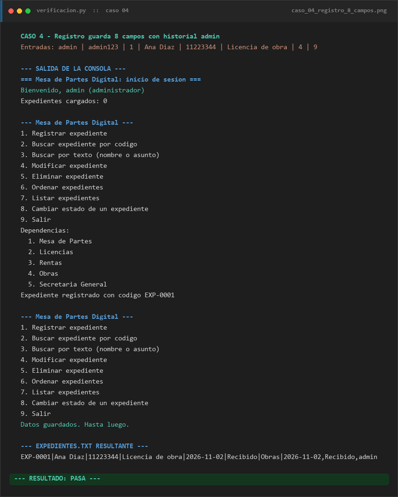
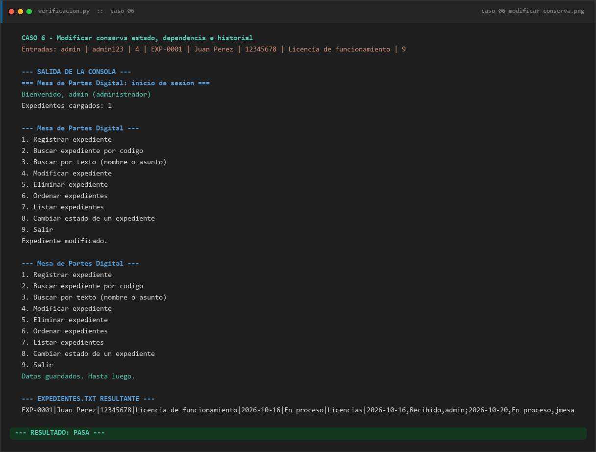
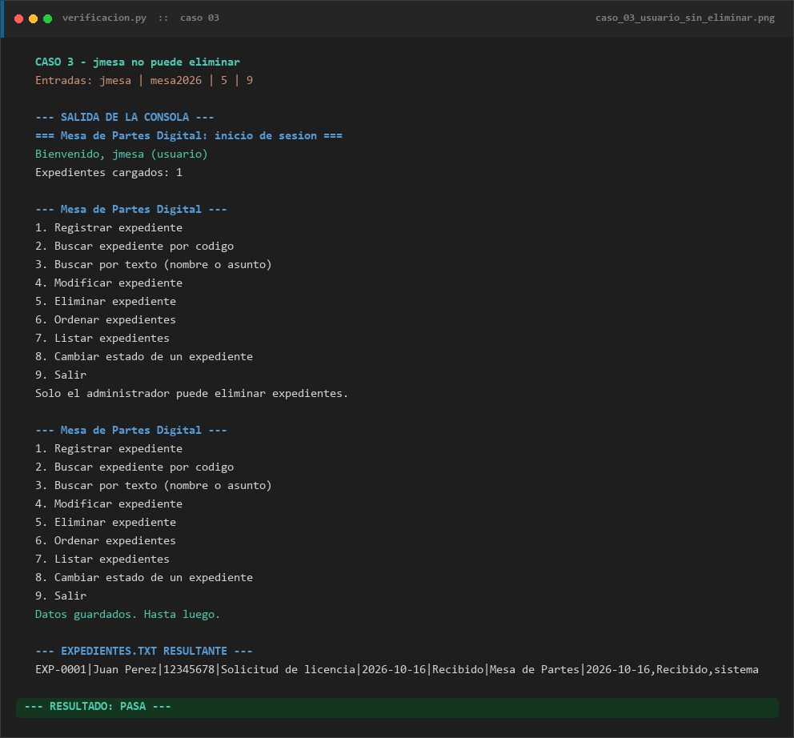
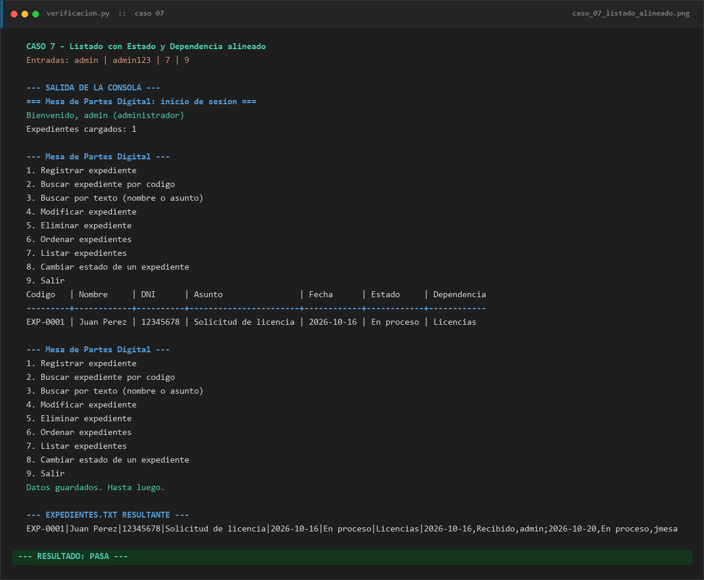
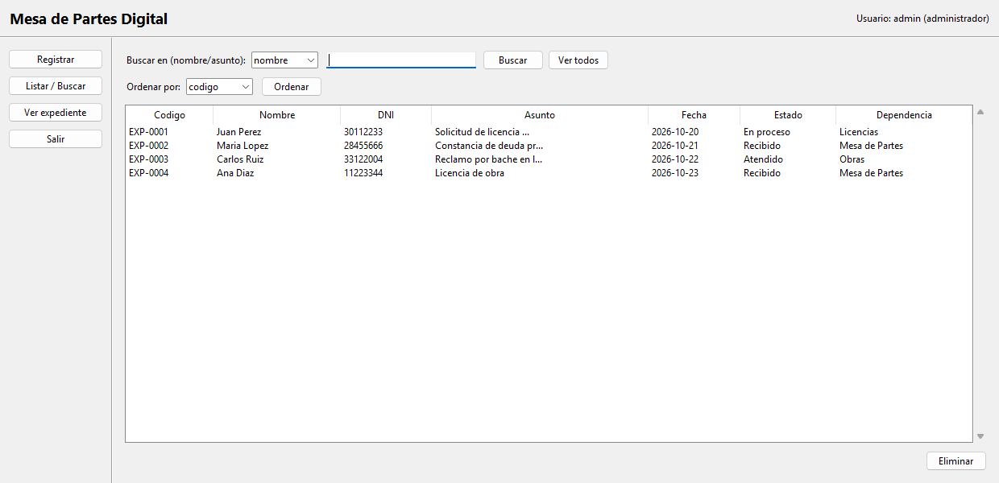
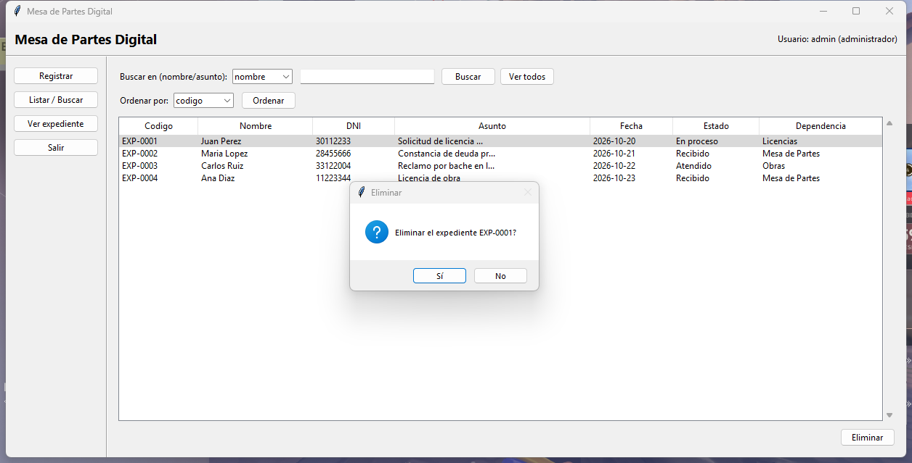
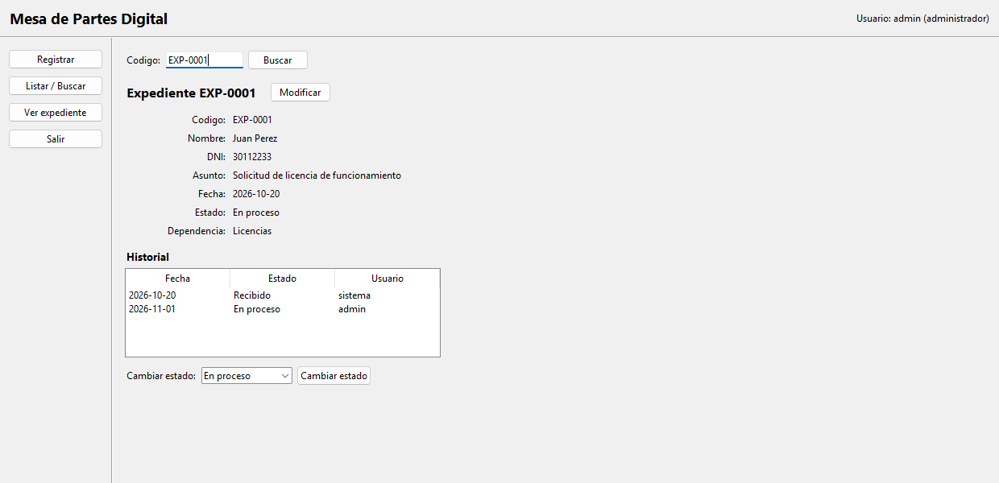
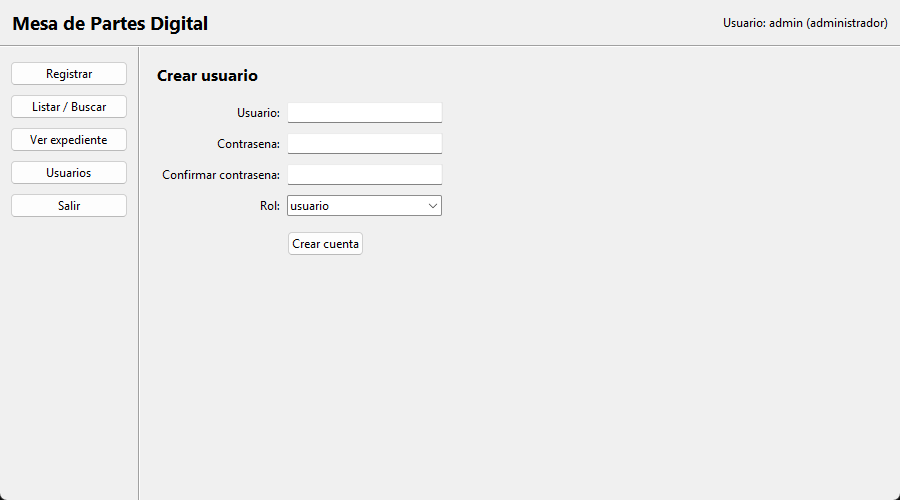

# Manual de usuario: Mesa de Partes Digital

Este manual explica cómo instalar, abrir y usar el sistema, tanto en la **consola** como en la **ventana** (interfaz gráfica). Está pensado para el personal que atiende la mesa de partes.

---

## 1. Requisitos e instalación

- **Python 3.10 o superior.** En Windows, el instalador oficial de python.org ya incluye `tkinter`, que es lo que usa la ventana. No hace falta instalar ninguna otra biblioteca.
- **Obtener el programa:**
  - Con Git: `git clone https://github.com/Krispsz/desafio-fundamentos-programacion.git`
  - Sin Git: en GitHub, **Code → Download ZIP**, y descomprimir.

## 2. Abrir el programa

| Para usar | Comando |
|---|---|
| La consola | `python main.py` |
| La ventana | `python gui.py` |

El programa encuentra sus archivos (`usuarios.txt`, `expedientes.txt`) aunque se ejecute desde otra carpeta.

## 3. Cuentas y roles

Para entrar se necesita usuario y contraseña. Hay **3 intentos**: tras el tercer error, el programa se cierra con "Acceso bloqueado". La contraseña distingue mayúsculas; el usuario no.

| Usuario | Contraseña | Rol | Qué puede hacer |
|---|---|---|---|
| `admin` | `admin123` | administrador | Todo, incluso eliminar expedientes y crear cuentas |
| `jmesa` | `mesa2026` | usuario | Todo menos eliminar y crear cuentas |

### Crear cuentas nuevas (solo administrador)

Las cuentas las crea el administrador desde el propio programa: en la consola con la **opción 10** y en la ventana con el botón **Usuarios** (sección 5.4). En los dos casos se piden el usuario, la contraseña, la confirmación y el rol.

| Regla | Si no se cumple |
|---|---|
| El usuario no puede estar vacío ni tener espacios, `\|`, `,` o `;` | "Usuario invalido" |
| La contraseña y su confirmación deben ser iguales | "Las contrasenas no coinciden" |
| La contraseña debe tener al menos 6 caracteres | "La contrasena debe tener al menos 6 caracteres" |
| El rol debe ser `administrador` o `usuario` | "Rol invalido" |
| El usuario no debe existir (sin importar mayúsculas) | "El usuario ya existe" |

Si todo está bien, aparece "Cuenta creada" y desde ese momento se puede entrar con la cuenta nueva. La contraseña nunca se guarda: se guarda su hash con una sal propia.



---

## 4. Uso en la consola

Después de entrar, el programa muestra cuántos expedientes cargó y el menú:

```
--- Mesa de Partes Digital ---
1. Registrar expediente
2. Buscar expediente por codigo
3. Buscar por texto (nombre o asunto)
4. Modificar expediente
5. Eliminar expediente
6. Ordenar expedientes
7. Listar expedientes
8. Cambiar estado de un expediente
9. Salir
10. Crear usuario (solo administrador)
```



### 4.1 Registrar (opción 1)

1. Escribe el **nombre**, el **DNI** (8 dígitos) y el **asunto**. Los espacios de más se corrigen solos y el nombre queda con mayúscula inicial.
2. Elige la **dependencia** por número.
3. El sistema asigna el código (`EXP-0001`, `EXP-0002`…) y la fecha de hoy. El expediente empieza en estado **Recibido**.

Si un dato no es válido (DNI sin 8 dígitos, campo vacío o el carácter `|`), aparece "Datos invalidos" y se piden de nuevo.



### 4.2 Buscar (opciones 2 y 3)

- **Por código (2):** escribe el código. Se aceptan minúsculas, por ejemplo `exp-0001`.
- **Por texto (3):** elige `nombre` o `asunto` y escribe una parte del texto. No distingue mayúsculas: `licen` encuentra "Solicitud de licencia".

### 4.3 Modificar (opción 4)

Escribe el código y los nuevos nombre, DNI y asunto. Se **conservan** la fecha, el estado, la dependencia y el historial.



### 4.4 Eliminar (opción 5, solo administrador)

Escribe el código. El rol `usuario` recibe "Solo el administrador puede eliminar expedientes."



### 4.5 Ordenar y listar (opciones 6 y 7)

- **Ordenar (6):** elige el criterio (`codigo`, `nombre`, `dni`, `asunto` o `fecha`). Se ordena con el algoritmo burbuja y el nuevo orden **se guarda al salir** (o con el siguiente cambio que se guarde).
- **Listar (7):** muestra la tabla con todas las columnas alineadas. Los asuntos largos se recortan con `...`.



### 4.6 Cambiar estado (opción 8)

Escribe el código y elige el nuevo estado: **Recibido**, **En proceso** o **Atendido**. El cambio queda en el **historial** con la fecha y tu usuario.

### 4.7 Crear usuario (opción 10, solo administrador)

Pide el usuario, la contraseña dos veces (no se ve al escribir) y el rol por número. Muestra "Cuenta creada" o el motivo por el que no se creó (ver sección 3). El rol `usuario` recibe "Solo el administrador puede crear usuarios."

### 4.8 Salir (opción 9)

Guarda los datos y cierra. Cada registro, modificación, eliminación o cambio de estado ya se guarda en el momento; al salir se guarda una vez más.

---

## 5. Uso en la ventana

Arriba a la derecha se ve el usuario y su rol. A la izquierda está el menú: **Registrar**, **Listar / Buscar**, **Ver expediente**, **Usuarios** (solo administrador) y **Salir**.

### 5.1 Listar, buscar, ordenar y eliminar

- **Buscar:** elige `nombre` o `asunto`, escribe el texto y pulsa **Buscar** o Enter.
- **Ver todos:** quita el filtro y vuelve a mostrar todos los expedientes.
- **Ordenar:** elige el criterio y pulsa **Ordenar**.
- **Doble clic en una fila:** abre el detalle del expediente.
- **Eliminar:** selecciona una fila y pulsa **Eliminar**. El programa pide confirmación. Este botón solo aparece para el administrador.





Con el rol `usuario`, la tabla es la misma pero **sin** el botón Eliminar:


### 5.2 Registrar

Completa Nombre, DNI y Asunto, elige la dependencia y pulsa **Registrar**. Aparece el código asignado.

### 5.3 Ver expediente, historial y cambio de estado

1. En **Ver expediente**, escribe el código y pulsa **Buscar**.
2. Se muestran los datos y el **historial** (fecha, estado y usuario de cada cambio).
3. Para cambiar el estado, elígelo en la lista y pulsa **Cambiar estado**.
4. Para corregir los datos, pulsa **Modificar**, cambia lo necesario y pulsa **Guardar cambios**, o **Cancelar** para volver sin cambiar nada.



### 5.4 Usuarios (solo administrador)

Formulario con Usuario, Contraseña, Confirmar contraseña y Rol (empieza en `usuario`, el de menos permisos). Al pulsar **Crear cuenta** aparece "Cuenta creada" o el motivo por el que no se creó.



### 5.5 Salir

Usa el botón **Salir** o la **X** de la ventana: las dos guardan antes de cerrar.

---

## 6. Dónde se guardan los datos

| Archivo | Qué contiene |
|---|---|
| `expedientes.txt` | Los expedientes, uno por línea, con los campos separados por `\|` |
| `usuarios.txt` | Las cuentas: usuario, sal, hash de la contraseña y rol. La contraseña no se guarda |
| `expedientes_rechazados.txt` | Copia de las líneas de `expedientes.txt` que no se pudieron leer, para no perderlas |
| `mesa_partes.db` | Solo si se activa SQLite (ver abajo) |

- **Copia de respaldo:** basta con copiar `expedientes.txt` (o `mesa_partes.db`) y `usuarios.txt`.
- **Usar SQLite en vez del archivo de texto:** en `persistencia.py`, cambia `ALMACENAMIENTO = "txt"` por `ALMACENAMIENTO = "sqlite"`. La primera vez, el programa copia solo los expedientes del `.txt` a la base.
- **No edites `usuarios.txt` a mano.** Para crear cuentas, usa la opción 10 o el botón **Usuarios**.

---

## 7. Mensajes frecuentes y qué hacer

| Mensaje | Qué significa | Qué hacer |
|---|---|---|
| "Usuario o contrasena incorrectos. Intentos restantes: N" | El usuario o la contraseña no coinciden | Revisa Bloq Mayús: la contraseña distingue mayúsculas |
| "Acceso bloqueado" | Se agotaron los 3 intentos | Vuelve a abrir el programa |
| "N expedientes tienen datos invalidos y deben corregirse: …" | Algún expediente del archivo tiene un dato mal (DNI, fecha, estado…) o hay una línea ilegible | El nombre, el DNI y el asunto se corrigen con **Modificar**, y el estado con **Cambiar estado**. La fecha, la dependencia o un código repetido no se pueden cambiar desde el programa: hay que corregirlos en `expedientes.txt` con el programa cerrado. Las líneas ilegibles quedan en `expedientes_rechazados.txt` |
| "Datos invalidos, intente de nuevo." | Al registrar o modificar, algún dato no cumple las reglas | DNI de 8 dígitos, campos no vacíos y sin `\|` |
| "Solo el administrador puede eliminar expedientes." / "…crear usuarios." | Tu rol no permite esa acción | Pide a un administrador que lo haga |
| "No se pudieron guardar los datos." | El archivo no se pudo escribir (permisos o disco lleno) | Revisa que la carpeta no esté protegida. Los datos anteriores no se pierden, porque el guardado es atómico |
| "No hay expedientes registrados." | La lista está vacía | Registra uno con la opción 1 |

---

## 8. Pruebas automáticas (para desarrolladores)

```bash
python -m unittest discover -s tests -v
```

Todas las pruebas trabajan en carpetas temporales y no tocan los datos reales.
